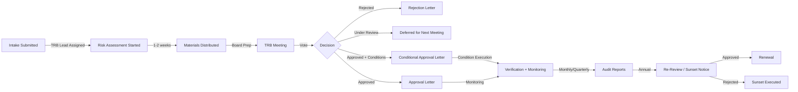

# TRB Documentation Corpus – README

## Overview

This directory contains the UNSTRUCTURED document corpus for Acme Health Plan's Technical Review Board (TRB). These documents support a Databricks Agent Knowledge Assistant that enables users to query TRB decisions, compliance rationale, conditions, and process guidance.

**Fictional Organization:** Acme Health Plan (synthetic)  
**Document Collection:** TRB charters, intake requests, risk assessments, meeting minutes, decision records, conditional approval letters, exception requests, and re-review notices.  
**Knowledge Assistant Use Case:** "Why did the TRB put conditions on Genie One?" → Assistant searches risk assessment + decision record + conditional approval letter and synthesizes answer.

---

## Document Types & Purpose

| Doc Type | Purpose | Owner | When Produced | Key Sections |
|----------|---------|-------|---------------|--------------|
| **Charter** | Governance framework; defines TRB composition, decision-making authority, review criteria, HIPAA compliance framework | CISO | Annually (or policy update) | Purpose, authority, composition, review criteria, decision framework, meeting schedule, escalation |
| **Review Intake Request** | Initial request from business unit; scope, use case, data sensitivity, known risks | Business unit + TRB lead | Submitted with feature proposal | Feature info, use case, data scope, security scoping, known risks, documentation |
| **Security & Privacy Risk Assessment** | NIST 800-30 risk analysis; threat identification, vulnerability assessment, risk scoring, mitigations | Enterprise Architect / Privacy Officer | During review (week 1–2 of intake) | Executive summary, context, threat analysis, vulnerability assessment, risk analysis, findings, residual risk |
| **Meeting Minutes** | Record of TRB board discussions, decisions, votes, action items | Compliance Officer (recorded) | After each biweekly TRB meeting | Attendance, agenda items, discussion points, board decisions, conditions, action items |
| **Decision Record (ADR)** | Architecture Decision Record; captures the "why" behind TRB decision (approved, rejected, conditional). Includes alternatives considered, rationale, conditions, consequences, compliance notes | CISO | Within 1 day of board vote | Context, decision, alternatives, conditions, consequences, residual risk, approval |
| **Conditional Approval Letter** | Binding approval letter sent to requestor; specifies conditions, timelines, obligations, next steps, monitoring plan | CISO | Within 1 day of board vote | Decision, conditions table, key terms, restrictions, monitoring schedule, action items, questions contact |
| **Exception Request** | Request to override a TRB decision (e.g., early GA use, expanded scope); includes business justification, risk analysis, mitigations | Business unit | When exception needed (before implementation) | What is requested, business justification, risk analysis, proposed mitigations, timeline, conditions offered, compliance certification |
| **Re-Review / Sunset Notice** | Notifies stakeholders of scheduled re-review or feature sunset; tracks condition compliance over time | TRB Lead | Annually (or per sunset trigger) | Notice type, current status, timeline, re-certification form (if re-review), compliance obligations, escalation |

---

## Document Lifecycle Across a Review



**Phases:**

1. **Intake (Day 0):** Business unit submits intake request. TRB lead assigned. Intake reviewed for completeness.
2. **Assessment (Week 1–2):** Risk assessment completed (threat identification, vulnerability analysis, risk scoring, mitigations).
3. **Board Preparation (Day -2):** All materials sent to TRB members.
4. **Meeting (Day 0):** Feature sponsor presents; board discusses; vote taken.
5. **Decision (Day +1):** Decision record signed; conditional approval letter issued (if applicable).
6. **Condition Execution (Per timeline, typically 4–6 weeks):** Requestor executes conditions; submits evidence. TRB verifies.
7. **Go-Live (Day +7 after verification):** Requestor receives approval; feature deployment begins.
8. **Monitoring (Ongoing, monthly/quarterly):** TRB conducts spot audits (query logs, condition compliance, anomaly detection).
9. **Annual Re-Review (Year 1):** TRB issues re-certification notice; requestor confirms conditions still met.
10. **Renewal or Sunset (Year 1+):** Feature renewed for another year, or sunset notice issued (if compliance gaps or phase deprecation).

---

## Knowledge Assistant Ingestion Notes

### File Format & Naming

**Markdown Files:**
- Format: GitHub-flavored Markdown (GFM)
- Extension: `.md`
- Encoding: UTF-8
- Line endings: LF (Unix)
- YAML Front-Matter: **Required** (see below)

**File Naming Conventions:**
```
templates/
  01-TRB-Charter.md
  02-Review-Intake-Request.md
  03-Security-Privacy-Risk-Assessment.md
  04-Meeting-Minutes.md
  05-Decision-Record.md
  06-Conditional-Approval-Letter.md
  07-Exception-Request.md
  08-Sunset-Rereview-Notice.md

samples/
  charter-sample.md
  minutes-TRBM-2026-07-14.md
  minutes-TRBM-2026-07-28.md
  [... 4 more minutes files ...]
  intake-TRB-2026-006-knowledge-assistant.md
  intake-TRB-2026-009-mcp-servers.md
  risk-assessment-TRB-2026-005-genie-one.md
  risk-assessment-TRB-2026-007-mode-databricks-to-open.md
  decision-record-DR-2026-005.md
  [... more decision records ...]
  approval-letter-TRB-2026-005.md
  [... more approval letters ...]
  exception-EXC-2026-001.md
```

### YAML Front-Matter (Metadata Header)

**Every document MUST include a YAML header** (between `---` delimiters) at the top. This enables Knowledge Assistant to index, search, and cite documents.

**Template:**
```yaml
---
doc_type: "[Document type; must match table above]"
doc_id: "[Unique ID]"
[optional: review_id: "TRB-YYYY-NNN"]
[optional: meeting_id: "TRBM-YYYY-MM-DD"]
[optional: feature_key: "Feature Name"]
date: YYYY-MM-DD
[optional: status: "Submitted / Approved / Under Review / Rejected / Retired"]
[optional: conditions: ["COND-XXX-1", "COND-XXX-2"]]
classification: "Internal – Synthetic Sample"
---
```

**Examples:**
```yaml
# Charter
doc_type: "TRB Charter"
doc_id: "CHARTER-2026"
date: 2026-07-01
status: "Active"

# Intake Request
doc_type: "Review Intake Request"
doc_id: "TRB-2026-005"
review_id: "TRB-2026-005"
feature_key: "Genie One"
date: 2026-07-21
status: "Submitted"

# Decision Record
doc_type: "Decision Record"
doc_id: "DR-2026-005"
review_id: "TRB-2026-005"
feature_key: "Genie One"
date: 2026-07-28
status: "Accepted"
conditions: ["COND-005-1", "COND-005-2", "COND-005-3", "COND-005-4"]
```

### Chunking Strategy for Knowledge Assistant

Documents are chunked at these boundaries (to keep context windows manageable for LLM):

1. **Sections (Primary Chunks):** Each major section (# heading) is a chunk.
   - Example: "Risk Assessment > Section 4. Risk Analysis" = one chunk
   - Includes subsections; typically 300–1000 tokens per chunk

2. **Sub-sections (If Needed):** Large sections split further.
   - Example: "Section 3. Threat & Vulnerability Analysis" → separate chunks for "Threat Sources" and "Vulnerability Assessment"

3. **Tables (Preserved Inline):** Markdown tables are preserved as-is within chunks (not extracted separately).

4. **Metadata Retention:** YAML front-matter is preserved at the top of every chunk (helps assistant cite the document).

**Chunking Example (Risk Assessment):**
- Chunk 1: YAML + Executive Summary
- Chunk 2: Risk Assessment Context
- Chunk 3: Threat & Vulnerability (Threat Sources)
- Chunk 4: Threat & Vulnerability (Vulnerability Assessment – Admin Safeguards)
- Chunk 5: Threat & Vulnerability (Technical Safeguards)
- Chunk 6: Risk Analysis (Risk Calculation)
- Chunk 7: Findings & Conditions
- Chunk 8: Residual Risk, Compliance Notes, Recommendation

---

## Document-to-Database Key Mapping

**Structured TRB tables** are maintained in parallel (separate agent). This corpus maps to those tables via shared keys:

| Table | Key | Maps to Document | Relationship |
|-------|-----|------------------|--------------|
| **Reviews** | `review_id` (TRB-YYYY-NNN) | Intake Request + Risk Assessment + Decision Record | One review per row; references all related documents |
| **Features** | `feature_key` | Across all documents (intake, risk assessment, decision record) | Identified in YAML front-matter; enables cross-feature analysis |
| **Decisions** | `decision_id` (DR-YYYY-NNN) | Decision Record | One decision record per review; contains reasoning, conditions, approval |
| **Conditions** | `condition_id` (COND-XXX-Y) | Conditional Approval Letter + Decision Record + Risk Assessment | Conditions table rows link back to decision record + approval letter |
| **Exceptions** | `exception_id` (EXC-YYYY-NNN) | Exception Request + Exception Decision Record | One exception request per row; cross-referenced with original review |
| **Meetings** | `meeting_id` (TRBM-YYYY-MM-DD) | Meeting Minutes | Minutes document; can reference multiple reviews discussed at one meeting |

**Example Query to Knowledge Assistant:**
- **User Ask:** "What were the conditions on Genie One?"
- **Assistant Finds:**
  1. Reviews table: find row where `feature_key = "Genie One"` and `review_id = "TRB-2026-005"`
  2. Conditions table: find rows where `review_id = "TRB-2026-005"` (returns COND-005-1 through COND-005-4)
  3. Decision Record (DR-2026-005): retrieve Section 4 (Conditions for Approval) from this corpus
  4. Conditional Approval Letter (APL-TRB-2026-005): retrieve Section "Conditions Required Before Deployment"
  5. Synthesize: List all 4 conditions with requirement, verification method, owner, deadline from the documents

---

## Sourcing & Inspiration

This corpus draws from publicly available materials and best practices:

### Templates & Frameworks
- **ADR (Architecture Decision Records):** [adr.github.io](https://adr.github.io) — Nygard's ADR template (45 CFR §); adapted for TRB context
- **NIST SP 800-30 Risk Assessment:** Risk identification, analysis, and mitigation framework (3-step process)
- **AWS Shared Responsibility Model:** Classification of inherited vs. shared vs. customer-specific controls
- **HIPAA Security Rule (45 CFR § 164.308–314):** Administrative, Technical, Physical safeguards structure
- **Federal TRB Practices:** General governance model (based on GSA, VA, CMS IT governance structures; no single source)

### Document Types Included
- **Charter:** Adapted from university ARB charters and federal IT governance charters (general structure)
- **Intake Form:** Common across IT governance frameworks
- **Risk Assessment:** Follows NIST 800-30 three-step methodology
- **Meeting Minutes:** Standard meeting documentation practice
- **Decision Record:** ADR template from adr.github.io
- **Approval Letter:** Standard legal/compliance approval letter format
- **Exception Request:** Common change management exception forms (adapted for architecture review)
- **Re-Review/Sunset Notice:** Based on software lifecycle management practices

### Why These Document Types?
These 8 types cover the **complete lifecycle** of a TRB review:
1. **Intake Request** — Define scope
2. **Risk Assessment** — Assess risk (NIST methodology)
3. **Meeting Minutes** — Record decision process
4. **Decision Record** — Explain decision rationale
5. **Conditional Approval Letter** — Communicate decision + binding conditions
6. **Exception Request** — Handle deviations/waivers
7. **Re-Review/Sunset Notice** — Manage ongoing compliance
8. **Charter** — Define governance framework

---

## How to Use This Corpus with Knowledge Assistant

### 1. Upload Documents
Upload all `.md` files from `samples/` (and optionally `templates/`) to your Databricks Knowledge Assistant workspace.

```bash
# Example (pseudo-code for Knowledge Assistant upload)
databricks knowledge-assistant upload \
  --source-dir ./samples \
  --workspace-id [workspace_id] \
  --index-name "TRB-Docs-2026" \
  --chunk-strategy "by-section"
```

### 2. Index Metadata
Knowledge Assistant automatically indexes YAML front-matter. Verify indexed fields:
- `doc_type`, `doc_id`, `review_id`, `feature_key`, `date`, `status`, `conditions`, `classification`

### 3. Example Queries

**Query 1: "What is the TRB's policy on Genie One with PHI data?"**
- Search: `feature_key = "Genie One"` + `doc_type IN ["Decision Record", "Conditional Approval Letter"]`
- Result: DR-2026-005 (Decision Record) → Section 2 (Decision), Section 4 (Conditions)
- Answer: "Genie One is approved for PHI use with 4 conditions: (1) audit logging, (2) row-level filtering, (3) response monitoring, (4) user training."

**Query 2: "Why was Kafka Connector rejected?"**
- Search: `feature_key = "Kafka"` + `doc_type = "Decision Record"`
- Result: DR-2026-004 (Rejection) → Section 3 (Alternative Decisions Considered) or Section 4 (Rationale)
- Answer: "Kafka Connector is in Beta, not GA. Per TRB charter, Beta features are out of compliance scope (no SLA for production). Audit trail for streaming is complex and untested. Row-level filtering not available."

**Query 3: "What conditions are on Mode (Databricks-to-Open) for member claims sharing?"**
- Search: `feature_key = "Mode"` + `review_id = "TRB-2026-007"` + `doc_type = "Conditional Approval Letter"`
- Result: APL-TRB-2026-007 → Table (Conditions) + Section "Key Terms & Restrictions"
- Answer: "3 conditions: (1) BAA signed with external recipient, (2) bearer token ≤30 days + IP allowlist, (3) monthly anomaly audit."

**Query 4: "Is the SQL Server Connector approved for member data?"**
- Search: `feature_key = "SQL Server"` + `doc_type = "Decision Record"` OR `doc_type = "Exception Request"`
- Result: DR-2026-003 (Approved non-PHI only) + EXC-2026-001 (Pilot for limited PHI use)
- Answer: "Approved for non-PHI only (counts, aggregates). Exception EXC-2026-001 grants 90-day pilot for member name + ID for annual reconciliation (phased waiver)."

**Query 5: "What was discussed about ABAC at the TRB meetings?"**
- Search: `feature_key = "ABAC"` + `doc_type = "Meeting Minutes"`
- Result: TRBM-2026-07-28 (deferred for Okta review), TRBM-2026-08-25 (approved after review)
- Answer: "Initially under review pending security assessment of Okta integration (attribute source). Re-reviewed Aug 25 after Okta controls validated; approved."

---

## File List & Summary

### Templates (Blank)
- `01-TRB-Charter.md` — 85 lines
- `02-Review-Intake-Request.md` — 110 lines
- `03-Security-Privacy-Risk-Assessment.md` — 190 lines
- `04-Meeting-Minutes.md` — 100 lines
- `05-Decision-Record.md` — 210 lines
- `06-Conditional-Approval-Letter.md` — 210 lines
- `07-Exception-Request.md` — 240 lines
- `08-Sunset-Rereview-Notice.md` — 160 lines

**Templates Total:** ~1,105 lines

### Samples (Filled-In)
- `charter-sample.md` — 195 lines
- `minutes-TRBM-2026-07-14.md` — 160 lines
- `minutes-TRBM-2026-07-28.md` — 120 lines
- `minutes-TRBM-2026-08-11.md` — 60 lines
- `minutes-TRBM-2026-08-25.md` — 90 lines
- `minutes-TRBM-2026-09-08.md` — 85 lines
- `minutes-TRBM-2026-09-22.md` — 65 lines
- `intake-TRB-2026-006-knowledge-assistant.md` — 160 lines
- `intake-TRB-2026-009-mcp-servers.md` — 165 lines
- `risk-assessment-TRB-2026-005-genie-one.md` — 220 lines
- `risk-assessment-TRB-2026-007-mode-databricks-to-open.md` — 210 lines
- `decision-record-DR-2026-005.md` — 260 lines
- `approval-letter-TRB-2026-005.md` — 240 lines
- `exception-EXC-2026-001.md` — 350 lines

**Samples Total:** ~2,380 lines

---

## Conditions Defined (Per Key Contract)

**All conditions satisfy the shared key contract and map directly to the table agent's rows:**

| Condition ID | Review ID | Requirement | Verification | Owner | Deadline |
|--------------|-----------|-------------|--------------|-------|----------|
| COND-003-1 | TRB-2026-003 | SQL Server Connector limited to non-PHI tables | Monthly query audit logs | Data Governance | 2026-08-14 |
| COND-003-2 | TRB-2026-003 | On-prem SQL Server TLS validation + encryption audit | Review before provisioning | Requestor | 2026-09-14 |
| COND-005-1 | TRB-2026-005 | Genie query audit logging (prompt + SQL + result count) | TRB audits system tables | Analytics Manager | 2026-09-15 |
| COND-005-2 | TRB-2026-005 | Row-level access control tested with 3 test identities | TRB test queries | Analytics Manager | 2026-09-15 |
| COND-005-3 | TRB-2026-005 | Monthly audit of 10 random Genie results; suppress count < 5 | TRB spot-checks | Databricks Support + Analytics | Ongoing monthly |
| COND-005-4 | TRB-2026-005 | User training (Databricks & HIPAA); annual refresher | Training completion certs | Analytics Manager | 2026-09-15 |
| COND-007-1 | TRB-2026-007 | BAA signed with external recipient before Mode token issued | Legal confirms BAA on file | Requestor | Per engagement |
| COND-007-2 | TRB-2026-007 | Bearer token lifetime ≤30 days; IP allowlist; quarterly rotation | Spot-check 3 active shares | TRB | 2026-10-25 |
| COND-007-3 | TRB-2026-007 | Mode query audit logs (180 days); monthly anomaly review | Query audit review | Platform Eng | 2026-10-25 & ongoing |

---

## Open Questions for Follow-Up

1. **Kafka Connector Re-Submission:** When Kafka reaches GA, does the current risk assessment need full refresh, or can TRB do streamlined re-review given existing documentation?
   
2. **Knowledge Assistant Sandbox Pilot:** TRB-2026-006 is approved for 90-day non-PHI sandbox. What triggers graduation from sandbox to production PHI use? (Expect re-review at TRBM-2026-11-24.)

3. **MCP Servers Risk Model:** TRB-2026-009 proposes FDA API + internal eligibility system. Should each MCP server integration require separate TRB approval, or does feature-level approval (once) cover all server types?

4. **Exception EXC-2026-001 Renewal:** Finance Department pilot (member name + ID via SQL Server) expires Dec 31, 2026. Should requestor file renewal exception by Nov 15, or migrate to standard TRB approval for permanent "member ID + name" scope?

---

## Compliance & Regulatory References

**Documents cite and comply with:**
- **HIPAA Security Rule (45 CFR §§ 164.308, 164.312, 164.314):** Administrative, technical, and physical safeguards
- **HIPAA Privacy Rule (45 CFR § 164.502–514):** PHI definitions, use/disclosure rules, Business Associate requirements
- **NIST SP 800-30 Rev. 1:** Risk Management Guide for IT systems
- **NIST SP 800-66:** Implementing HIPAA Security Rule guidance
- **NIST Cybersecurity Framework v1.1:** Identify, Protect, Detect, Respond, Recover
- **AWS Shared Responsibility Model:** Customer vs. AWS responsibility delineation

---

## Version History

| Version | Date | Changes | Author |
|---------|------|---------|--------|
| 1.0 | 2026-10-08 | Initial corpus creation; 8 templates + 13 samples | TRB Documentation Team |

---

## Contact & Questions

- **TRB Lead Reviewer:** [Enterprise Architect] — [email@acmehealthplan.com]
- **Compliance Officer (Document Curator):** [Compliance Officer] — [email@acmehealthplan.com]
- **Knowledge Assistant Administrator:** [IT/Data Governance] — [email@acmehealthplan.com]

---

**Classification:** Internal – Synthetic Sample  
**Last Updated:** October 8, 2026
