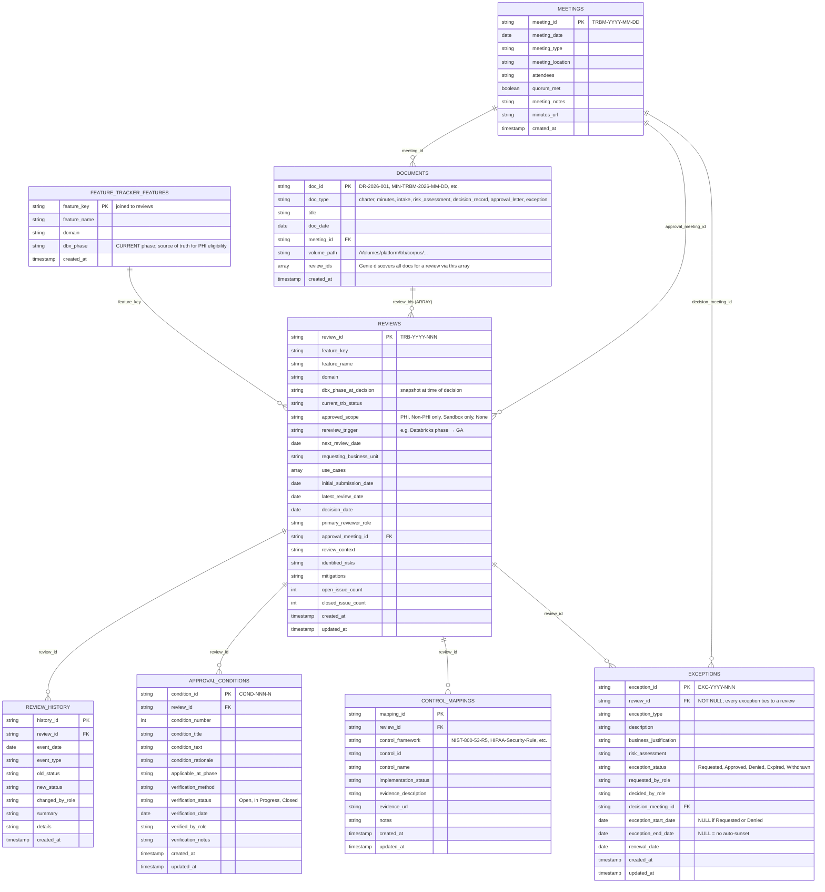

# Structured TRB Data Model for Acme Health Plan

**Purpose**: Databricks Feature Tracker governance database (platform.trb schema) for a healthcare payer's Tech Review Board. Dual-approval model: current Databricks phase (from feature_tracker.features) × TRB status → computed PHI eligibility.

**Org**: Acme Health Plan (synthetic). All reviewers referenced by role only (CISO, Chief Privacy Officer, Enterprise Architect, Platform Engineering Lead, Data Governance Lead, Compliance Officer).

**Single source of truth**: CANONICAL.md. All rows in trb/table/ and trb/docs/ must match exactly.

---

## ER Diagram



---

## Schema & Tables

**Schema**: `platform.trb` (owns TRB governance tables). Joined read-only to `platform.feature_tracker` (weekly job).

### `meetings`
TRB governance calendar. Biweekly meetings where decisions are made.

| Column | Type | Notes |
|--------|------|-------|
| `meeting_id` | STRING | PK: `TRBM-YYYY-MM-DD` |
| `meeting_date` | DATE | Meeting date |
| `meeting_type` | STRING | in-person, virtual, hybrid |
| `meeting_location` | STRING | Where/platform |
| `attendees` | STRING | Comma-separated role names |
| `quorum_met` | BOOLEAN | Decision-making quorum |
| `meeting_notes` | STRING | Summary of topics |
| `minutes_url` | STRING | Link to full minutes |

---

### `reviews`
Main fact table. One row = one TRB review cycle for a Databricks feature. **PHI eligibility is computed by view, not stored.**

| Column | Type | Notes |
|--------|------|-------|
| `review_id` | STRING | PK: `TRB-YYYY-NNN` |
| `feature_key` | STRING | `feature_name@domain` (unique org-wide) |
| `feature_name` | STRING | Human-readable name |
| `domain` | STRING | Databricks feature domain |
| `dbx_phase_at_decision` | STRING | Snapshot: phase when decision made. **Current phase is in feature_tracker.features** |
| `current_trb_status` | STRING | Latest: Not Reviewed, Under Review, Approved with Conditions, Approved, Rejected, Retired |
| `approved_scope` | STRING | If Approved: PHI \| Non-PHI only \| Sandbox only (synthetic data) \| None |
| `rereview_trigger` | STRING | Condition for re-review (e.g., "Databricks phase → GA") |
| `next_review_date` | DATE | Scheduled review or condition verification date |
| `requesting_business_unit` | STRING | Business unit requesting feature |
| `use_cases` | ARRAY<STRING> | Business drivers (e.g., ["BI analytics", "ad-hoc exploration"]) |
| `initial_submission_date` | DATE | First submission to TRB |
| `latest_review_date` | DATE | Most recent review date |
| `decision_date` | DATE | When final decision was made (null if pending) |
| `primary_reviewer_role` | STRING | Lead reviewer role |
| `approval_meeting_id` | STRING | FK to meetings (where decision made) |
| `review_context` | STRING | Why submitted? Business need, risk, trigger |
| `identified_risks` | STRING | Comma-separated list |
| `mitigations` | STRING | Proposed/active mitigations |
| `open_issue_count` | INT | Unresolved objections |
| `closed_issue_count` | INT | Resolved issues |

---

### `review_history`
Audit log of status changes and events. Immutable (append-only).

| Column | Type | Notes |
|--------|------|-------|
| `history_id` | STRING | PK: UUID |
| `review_id` | STRING | FK to reviews |
| `event_date` | DATE | When event occurred |
| `event_type` | STRING | status_change, condition_added, meeting_presented, objection_raised, etc. |
| `old_status`, `new_status` | STRING | (if status_change event) |
| `changed_by_role` | STRING | Role making the change |
| `summary` | STRING | Human-readable summary |
| `details` | STRING | Additional context |

---

### `approval_conditions`
Specific compliance conditions on "Approved with Conditions" decisions.

| Column | Type | Notes |
|--------|------|-------|
| `condition_id` | STRING | PK: `COND-NNN-N` (e.g., `COND-005-1`) |
| `review_id` | STRING | FK to reviews |
| `condition_number` | INT | Sequential (1, 2, 3, ...) |
| `condition_title` | STRING | Short label |
| `condition_text` | STRING | Full requirement |
| `condition_rationale` | STRING | Why? Cite HIPAA/NIST control |
| `applicable_at_phase` | STRING | GA, Public Preview, All Phases |
| `verification_method` | STRING | How will it be verified? |
| `verification_status` | STRING | Open, In Progress, Closed |
| `verification_date` | DATE | When verified (null if open) |
| `verified_by_role` | STRING | Role of verifier |
| `verification_notes` | STRING | Verification details |

**Rule**: A review moves from "Approved with Conditions" to "Approved" only after ALL conditions verify to Closed.

---

### `control_mappings`
Links reviews to NIST/HIPAA/HITRUST control requirements.

| Column | Type | Notes |
|--------|------|-------|
| `mapping_id` | STRING | PK: UUID |
| `review_id` | STRING | FK to reviews |
| `control_framework` | STRING | NIST-800-53-R5, HIPAA-Security-Rule, HITRUST-CSF, ISO27001, etc. |
| `control_id` | STRING | Framework ID (e.g., AC-2, 45 CFR 164.312(a)(2)(i)) |
| `control_name` | STRING | Human-readable name |
| `implementation_status` | STRING | Satisfied, Partially Satisfied, Not Addressed, N/A, Compensating Control |
| `evidence_description` | STRING | How is control satisfied? |
| `evidence_url` | STRING | Link to evidence |
| `notes` | STRING | Caveats |

---

### `documents`
TRB governance documents (minutes, risk assessments, decision records, exception justifications). Links to unstructured corpus in UC volumes.

| Column | Type | Notes |
|--------|------|-------|
| `doc_id` | STRING | PK (e.g., DR-2026-001, MIN-TRBM-2026-07-14, INT-006, RA-005, CAL-2026-005, etc.) |
| `doc_type` | STRING | charter, minutes, intake, risk_assessment, decision_record, approval_letter, exception |
| `title` | STRING | Document title |
| `doc_date` | DATE | Document date |
| `meeting_id` | STRING | FK to meetings (nullable; not all docs are from meetings) |
| `volume_path` | STRING | Path in UC: `/Volumes/platform/trb/corpus/<file>.md` |
| `review_ids` | ARRAY<STRING> | Array of review_ids referenced in doc. **Genie uses this to discover all docs for a review.** |

**Why ARRAY instead of bridge table?** Genie's natural language engine works better with denormalized data. "Show me all documents for Genie One" queries the documents table directly, filters by review_id in the array, and returns the volume_path for linking to Knowledge Assistant.

---

### `exceptions`
Approved/requested deviations from policy, with lifecycle tracking.

| Column | Type | Notes |
|--------|------|-------|
| `exception_id` | STRING | PK: `EXC-YYYY-NNN` (e.g., EXC-2026-001) |
| `review_id` | STRING | **NOT NULL** FK to reviews (every exception ties to a review) |
| `exception_type` | STRING | PHI-Restriction, Production-Prohibition, Condition-Waiver, Control-Gap-Acceptance, Sunset-Waiver |
| `description` | STRING | What is the exception? |
| `business_justification` | STRING | Why is it needed? |
| `risk_assessment` | STRING | Risks + compensating controls |
| `exception_status` | STRING | Requested, Approved, Denied, Expired, Withdrawn |
| `requested_by_role` | STRING | Role requesting |
| `decided_by_role` | STRING | Role making the decision |
| `decision_meeting_id` | STRING | FK to meetings (nullable; not all decisions in a meeting) |
| `exception_start_date` | DATE | When effective (null if Requested or Denied) |
| `exception_end_date` | DATE | Sunset date (null = no auto-expiration) |
| `renewal_date` | DATE | When next review due |

---

## Views

### `v_feature_phi_eligibility`
Computed PHI eligibility. Joins reviews to current phase from feature_tracker.features.

```sql
SELECT
  review_id, feature_key, feature_name, domain,
  current_dbx_phase,          -- from feature_tracker.features (current)
  dbx_phase_at_decision,      -- from reviews (snapshot)
  current_trb_status,
  approved_scope,
  is_phi_eligible,            -- TRUE iff current_phase = 'GA' AND status = 'Approved'
  blocking_reason,            -- "PHI-eligible", "GA + conditions (2 open)", "Pre-GA (non-PHI only)", etc.
  open_conditions_count,
  initial_submission_date,
  decision_date,
  next_review_date
FROM v_feature_phi_eligibility
```

**PHI rule**: `is_phi_eligible = (f.dbx_phase = 'GA' AND r.current_trb_status = 'Approved')`. Phase comes from live feature_tracker.features. "Approved with Conditions" is NOT PHI-eligible until all conditions close and status updates to "Approved".

---

### `v_open_conditions`
All unverified/in-progress conditions across all reviews. Used for compliance follow-up scheduling.

```sql
SELECT
  condition_id, review_id, feature_key, feature_name,
  condition_title, condition_rationale,
  verification_status, verification_method,
  verified_by_role, verification_notes
FROM v_open_conditions
WHERE verification_status IN ('Open', 'In Progress')
ORDER BY review_id, condition_number
```

---

## Example Genie Questions & SQL

### Q1: Which features are PHI-eligible today?
```sql
SELECT feature_key, feature_name, domain, current_dbx_phase, current_trb_status, approved_scope
FROM v_feature_phi_eligibility
WHERE is_phi_eligible = TRUE
ORDER BY decision_date DESC;
```

### Q2: Which features are GA but blocked from PHI?
```sql
SELECT feature_key, blocking_reason, open_conditions_count, next_review_date
FROM v_feature_phi_eligibility
WHERE current_dbx_phase = 'GA' AND is_phi_eligible = FALSE
ORDER BY feature_key;
```

### Q3: Show all open conditions and their verification status.
```sql
SELECT condition_id, feature_key, condition_title, verification_status, verified_by_role
FROM v_open_conditions
ORDER BY review_id, condition_number;
```

### Q4: What exceptions are currently active?
```sql
SELECT exception_id, feature_key, description, exception_start_date, exception_end_date
FROM exceptions
WHERE exception_status = 'Approved'
  AND exception_start_date <= CURRENT_DATE
  AND (exception_end_date IS NULL OR exception_end_date > CURRENT_DATE)
ORDER BY exception_end_date;
```

### Q5: Which features need re-review?
```sql
SELECT review_id, feature_key, rereview_trigger, next_review_date
FROM reviews
WHERE rereview_trigger IS NOT NULL
  AND (next_review_date IS NULL OR next_review_date <= CURRENT_DATE + INTERVAL 30 DAY)
ORDER BY next_review_date;
```

### Q6: Show the decision timeline for a specific feature.
```sql
SELECT event_date, event_type, old_status, new_status, changed_by_role, summary
FROM review_history
WHERE review_id = 'TRB-2026-005'  -- Genie One
ORDER BY event_date ASC;
```

### Q7: Which business units are requesting features?
```sql
SELECT requesting_business_unit, COUNT(*) as feature_count, ARRAY_AGG(feature_key) as features
FROM reviews
WHERE requesting_business_unit IS NOT NULL
GROUP BY requesting_business_unit
ORDER BY feature_count DESC;
```

### Q8: What documents reference this review?
```sql
SELECT doc_id, doc_type, title, doc_date, volume_path
FROM documents
WHERE ARRAY_CONTAINS(review_ids, 'TRB-2026-005')  -- Genie One
ORDER BY doc_date DESC;
```

### Q9: Show approval letters for PHI-eligible features.
```sql
SELECT d.doc_id, d.title, r.feature_key, r.approved_scope
FROM documents d
JOIN reviews r ON ARRAY_CONTAINS(d.review_ids, r.review_id)
WHERE d.doc_type = 'approval_letter'
  AND r.is_phi_eligible = TRUE
ORDER BY d.doc_date DESC;
```

### Q10: Exception requests and their decisions.
```sql
SELECT exception_id, feature_key, description, exception_status, decided_by_role, decision_meeting_id
FROM exceptions
ORDER BY exception_id DESC;
```

---

## Building the Genie Space

1. **Data source**: `platform.trb` schema
2. **Fact table**: `reviews` (one row per feature review)
3. **Joins**:
   - reviews → review_history (1:many on review_id)
   - reviews → approval_conditions (1:many on review_id)
   - reviews → control_mappings (1:many on review_id)
   - reviews → exceptions (1:many on review_id)
   - reviews → documents (many:many via ARRAY, or denormalized)
   - reviews → meetings (many:1 on approval_meeting_id)
   - reviews → feature_tracker.features (many:1 on feature_key) → current phase
4. **Primary view for Genie**: `v_feature_phi_eligibility` (pre-computed PHI eligibility with blocking reasons)
5. **Supporting view**: `v_open_conditions` (compliance follow-up)

### Semantic Layer
| Field | Type | Genie Synonyms |
|-------|------|----------------|
| `feature_key` | TEXT | feature, feature name, feature identifier |
| `domain` | CATEGORY | Databricks domain, product area |
| `current_dbx_phase` | CATEGORY | phase, Databricks phase, current phase, release stage |
| `current_trb_status` | CATEGORY | status, approval status, TRB status, compliance status |
| `approved_scope` | CATEGORY | scope, PHI scope, approved for PHI, sandbox only |
| `is_phi_eligible` | BOOLEAN | PHI-eligible, approved for PHI, cleared for PHI, healthcare-ready |
| `blocking_reason` | TEXT | why not PHI, blockers, open conditions, pending items |
| `exception_status` | CATEGORY | exception, waiver, deviation, approved exception, denied exception |

---

## Sources & Design Decisions

### Architecture Decision Records (ADRs)
**What we took**: Event audit trail (immutable review_history), decision snapshots (dbx_phase_at_decision), lifecycle status tracking, comprehensive rationale documentation.
**Shaped**: review_history table (append-only, immutable events); reviews.rereview_trigger (captures why/when re-review needed).

### NIST SP 800-53 Rev. 5 Security Controls
**What we took**: Control framework mappings (NIST control families: AC, AU, SI, etc.), implementation status assessment, evidence collection requirements.
**Shaped**: control_mappings table (links reviews to NIST/HIPAA/HITRUST controls); approval_conditions.condition_rationale (cites control references).

### HIPAA Security Rule (45 CFR 164.312)
**What we took**: Technical safeguard requirements (encryption, audit logs, access controls), organizational requirements (BAAs, workforce security), breach notification procedures.
**Shaped**: approved_scope values (PHI vs. Non-PHI only), condition tracking (encryption, audit logging, role-based access), exceptions (PHI-Restriction for non-GA features).

---

## Sample Data Notes

Sample data in `sample_data.sql` covers all 9 reviews from CANONICAL.md:
1. TRB-2026-001: Row filters & column masks (Approved, PHI-eligible)
2. TRB-2026-002: ABAC (Under Review)
3. TRB-2026-003: SQL Server CDC (Approved, Non-PHI only, Public Preview restriction)
4. TRB-2026-004: Kafka APIs (Rejected, Beta phase)
5. TRB-2026-005: Genie One (Approved with Conditions: 4 conditions, 2 Closed, 1 In Progress, 1 Open)
6. TRB-2026-006: Knowledge Assistant (Under Review, EXC-2026-002 Approved sandbox pilot)
7. TRB-2026-007: Mode: Databricks-to-Open (Approved with Conditions: 3 conditions, all Open)
8. TRB-2026-008: Databricks Apps (Under Review)
9. TRB-2026-009: MCP servers (Not Reviewed, intake submitted)

Plus: 6 meetings, 2 exceptions (1 Denied, 1 Approved), 19 documents (charter, minutes, risk assessments, decision records, approval letters).

---

## Integration Notes

- **Weekly job** (feature_tracker.features): Maintains current dbx_phase for all features. TRB tables snapshot the phase at review time.
- **Knowledge Assistant** (parallel agent): Unstructured TRB documents (minutes, memos, risk assessments) in UC corpus. documents.review_ids array links Genie answers to source documents.
- **Feature tracker index.html**: Seeded from reviews (feature_name, domain, dbx_phase_at_decision, current_trb_status) and v_feature_phi_eligibility (is_phi_eligible, blocking_reason).

---

**Version**: 2.0 (2026-10-08, reconciled with CANONICAL.md)
**Contact**: Platform Engineering Lead (TRB chair)
